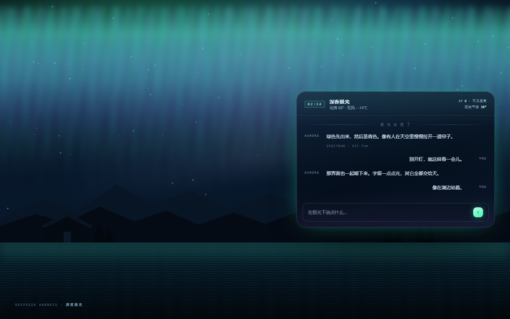

# 深夜极光 · DSH Theme

Midnight Aurora is a theme plugin for the [DeepSeek Harness](https://github.com/deepseek-ai/deepseek-harness) Web UI. It turns the canvas into an animated polar-night scene and the interface into translucent dark glass, without changing layout, typography or interaction.



## 效果

- 三层极光帘幕，绿 → 青 → 紫，26s / 34s / 42s 缓慢漂移
- 星空、银河、流星、山脊、针叶林与湖面倒影
- 面板改为半透明暗玻璃，强调色换成极光绿
- 覆盖 `--dsw-alias-*` 语义 token，不依赖哈希类名
- 尊重 `prefers-reduced-motion`；减少动效时帘幕静止
- 强制暗色，避免浅色模式下出现白字白底

主题只改变观感，不注册工具、命令或服务。

## 安装

DSH 0.2.1-rc.3 及以上的 Web profile：

```sh
dsh plugin --profile web add https://github.com/liu7654/dsh-theme-aurora
```

也可以从**设置 → 插件 → 安装**粘贴仓库地址，安装后刷新页面。

卸载：

```sh
dsh plugin --profile web remove dsh-theme-aurora
```

## 兼容性

- DSH：`>=0.2.1-rc.3 <0.3.0`
- 平台：Web（`dsh web` / `dsh --profile web`）
- 已在 DSH `0.2.1-rc.3` 的 Web profile 中安装验证

## 结构

```text
package.json        dsh.bundle.patch + dsh.client
cordis.patch.yml    注册 dsh-theme-aurora 这一行
index.js            Host 侧空实现
client.js           浏览器侧：场景层 + token 覆盖
locale/             中英文名称与描述
icon.svg            插件图标
preview.png         效果预览
```

`client.js` 通过 `window.__ModuleLoader__.load` 注册插件，在 `apply(ctx)` 中安装样式与场景，并返回清理函数。卸载时会移除注入的节点、恢复被透明化的壳层背景与 `color-scheme`。

## License

[MIT](LICENSE)
